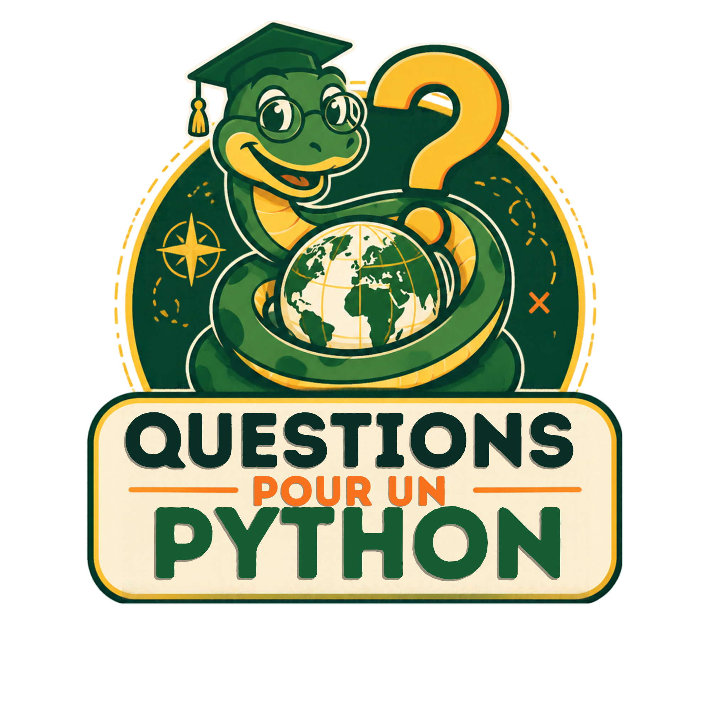
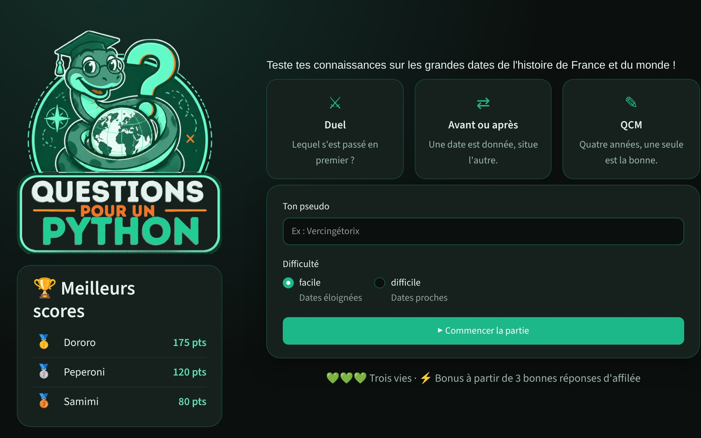
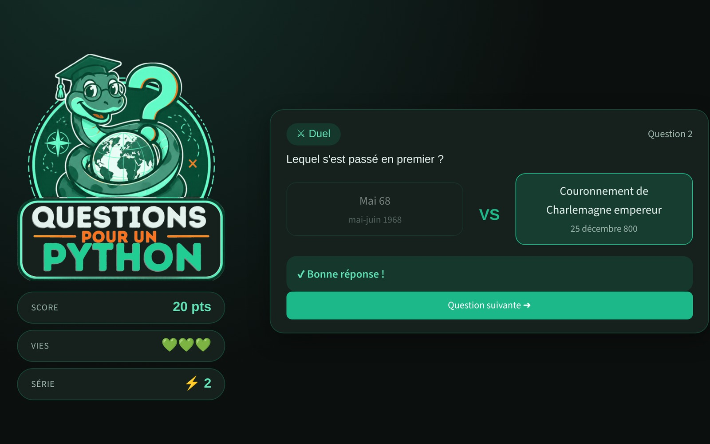
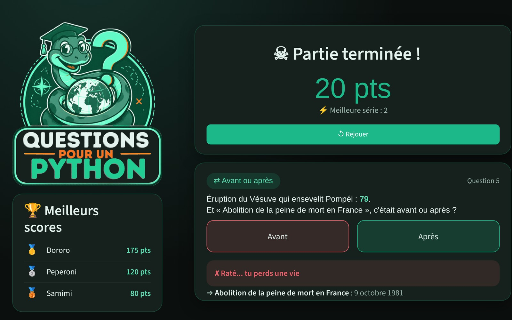

# Questions pour un Python

<p align="center">
  
</p>

<h1 align="center">Questions pour un Python</h1>

<p align="center"><b>Un quiz d'histoire codé en Python, pour la game jam de la formation</b></p>

<p align="center">Projet réalisé en binôme par Sami Kabdani et Dorothée Catry</p>

---

<p align="center">
  
  
  
</p>

<p align="center"><i>La page web faite avec Streamlit : l'accueil, une question, la fin de partie</i></p>

## Le principe

Un « plus ou moins » version histoire. À chaque tour, le jeu tire au hasard un type de question parmi trois, sur des grandes dates de l'histoire de France et du monde.

- **Le duel** : deux événements, il faut trouver lequel s'est passé en premier
  - "Lequel est le plus ancien : la loi Veil ou la prise de Constantinople ?"
- **Avant ou après** : le jeu donne la date d'un événement, il faut dire si le deuxième était avant ou après
  - "Le tunnel sous la Manche a été inauguré le 6 mai 1994. Et l'arrivée de la peste noire en Europe, c'était avant ou après ?"
- **Le QCM** : une question, quatre années proposées, une seule est juste
  - "En quelle année : chute du mur de Berlin ?"

Comme on ne sait jamais quelle question va tomber, le jeu ne devient pas répétitif.

On gagne 10 points par bonne réponse (15 pour le QCM), plus un bonus de 5 points à partir de 3 bonnes réponses d'affilée. On a 3 vies : au bout de 3 erreurs, la partie est finie et le score part dans le classement.

## Lancer le jeu

Le projet utilise [uv](https://docs.astral.sh/uv/) pour gérer l'environnement et les dépendances (pandas, numpy, streamlit).

```bash
uv sync
```

**Le jeu en console** (le vrai jeu) :

```bash
uv run python -m questions_pour_un_python
```

**La page web** (pour présenter le jeu à l'oral) :

```bash
uv run streamlit run app.py
```

## Comment on joue

1. On entre son pseudo
2. On choisit la difficulté
   - facile : les dates à comparer sont éloignées
   - difficile : les dates sont proches, il faut vraiment savoir
3. Le jeu pose les questions en mélangeant les trois types
   - duel et avant/après : on répond 1 ou 2
   - QCM : on répond 1, 2, 3 ou 4
4. Après chaque réponse, le jeu affiche les vraies dates
5. À la fin, le score est enregistré et on voit le classement

Un bout de partie en console :

```
☺ Doro | ★ 0 pts | ♥ ♥ ♥

═══════ ? Question 1 ? ═══════
⇄ Inauguration du tunnel sous la Manche : 6 mai 1994.
  Et « Arrivée de la peste noire en Europe », c'était avant ou après ?
  1. Avant
  2. Après
Ta réponse (1 ou 2) : 1
  ➜ Arrivée de la peste noire en Europe : 1347
✔ Bonne réponse !
☺ Doro | ★ 10 pts | ♥ ♥ ♥

═══════ ? Question 2 ? ═══════
⌛ Lequel s'est passé en premier ?
  1. Loi Veil sur l'IVG
  2. Prise de Constantinople par les Ottomans
Ta réponse (1 ou 2) : 2
  ➜ Loi Veil sur l'IVG : 17 janvier 1975
  ➜ Prise de Constantinople par les Ottomans : 29 mai 1453
✔ Bonne réponse !
☺ Doro | ★ 20 pts | ♥ ♥ ♥
```

## Structure du projet

```
questions-pour-un-python/
├── src/
│   └── questions_pour_un_python/
│       ├── __init__.py    # en fait un paquet
│       ├── __main__.py    # menu, lancé par python -m
│       ├── joueur.py      # classe Joueur
│       ├── partie.py      # classe Partie (boucle de jeu, questions)
│       ├── donnees.py     # lecture du CSV et tirage des questions
│       └── scores.py      # sauvegarde des scores et classement
├── data/
│   └── reperes_histoire.csv
├── assets/                # logo, style de la page web, captures
├── .streamlit/
│   └── config.toml        # thème de la page web
├── app.py                 # page Streamlit pour l'oral
├── scores.csv             # créé automatiquement à la première partie
├── pyproject.toml         # dépendances (uv)
├── uv.lock                # versions exactes installées
└── README.md
```

Un fichier par rôle : chacun a pu travailler sur ses fichiers sans gêner l'autre.

## Les données

Au départ, on voulait deux thèmes : histoire et géo. Mais trouver des CSV propres prenait trop de temps, et les fichiers de l'INSEE demandaient trop de nettoyage pour avoir deux fichiers semblables. On a donc généré un fichier de dates d'histoire.

Le fichier `data/reperes_histoire.csv` contient une soixantaine de dates connues de tous, de la fondation de Rome à l'euro, en France et dans le monde. Chaque date a été vérifiée sur Wikipédia, et la colonne `source` donne la page où elle a été lue. Quand le jour exact n'est pas sûr, on a gardé seulement le mois ou l'année.

Quelques choix :

- les dates avant J.-C. sont stockées en négatif (Alésia = -52) et affichées "52 av. J.-C."
- pour les périodes (ex : Première Guerre mondiale, 1914-1918), le jeu compare l'année de début
- le jeu ne met jamais face à face deux événements de la même année
- dans une partie, un événement déjà vu ne revient pas tout de suite

## Organisation

On a découpé le projet en deux rôles qui peuvent avancer en même temps.

**Sami : données et scores**

- `donnees.py` : lecture du CSV avec pandas, tirage des duels et des QCM selon la difficulté
- `scores.py` : sauvegarde des scores dans `scores.csv`, classement

**Dorothée : moteur de jeu**

- `joueur.py` : classe `Joueur` (pseudo, score, vies, série, bonus)
- `partie.py` : classe `Partie` (les trois types de questions, la boucle de jeu)
- `__main__.py` : menu en console

Pour que chacun puisse coder sans attendre l'autre, on a fixé au début ce que chaque fonction reçoit et renvoie :

| Fichier        | Fonction ou classe                      | Ce qu'elle fait                                                                    |
| -------------- | --------------------------------------- | ---------------------------------------------------------------------------------- |
| `donnees.py` | `charger_reperes()`                   | renvoie le tableau des dates, trié par année                                     |
| `donnees.py` | `tirer_duel(df, difficulte)`          | renvoie deux événements d'années différentes                                   |
| `donnees.py` | `tirer_qcm(df, nb_choix, difficulte)` | renvoie la bonne réponse, les propositions mélangées et la position de la bonne |
| `scores.py`  | `enregistrer_score(joueur)`           | ajoute le score à la fin de `scores.csv`                                        |
| `scores.py`  | `charger_scores()`                    | renvoie les scores, ou un tableau vide si le fichier n'existe pas                  |
| `joueur.py`  | `Joueur(pseudo)`                      | `bonne_reponse(points)`, `mauvaise_reponse()`, `est_vivant()`                |
| `partie.py`  | `Partie(joueur, df, difficulte)`      | `jouer_tour()`, `lancer()`                                                     |

Côté Git : une branche par fonctionnalité, des pull requests pour fusionner sur `main`, et des messages de commit du type `feat: ...`, `fix: ...`, `docs: ...`.

## Ce qu'on a appris en route

- **Les classes** : on a dû revoir `__init__`, `self`, les attributs et les méthodes pour écrire `Joueur` et `Partie`.
- **Le hasard avec numpy** : beaucoup de tutos utilisent `np.random.randint`, mais la doc de numpy conseille maintenant de créer un générateur (`rng = np.random.default_rng()`) et de lui demander les tirages (`rng.integers(...)`).
- **Streamlit** : le vrai jeu tourne en console. Pour l'oral, on a généré une page Streamlit, qui réutilise les mêmes fichiers. Streamlit, c'est pratique pour un prototype : un seul fichier `app.py`, une commande, et on peut quand même styliser avec un thème et du CSS. On n'a pas eu le temps d'en revoir les bases en détail.

## Notions du cours utilisées

- variables, types, conditions, boucles (la boucle de jeu)
- fonctions
- listes et dictionnaires (les propositions du QCM, les types de questions)
- fichiers (lecture du CSV, sauvegarde des scores)
- POO (classes `Joueur` et `Partie`)
- modules (un fichier par rôle, rangés en paquet dans `src/`)
- gestion des erreurs (try / except sur les saisies et les fichiers)
- pandas pour les données, numpy pour les tirages au hasa

**Un quiz d'histoire en console**

Petit jeu fait en Python pendant la game jam de la formation.

Le principe : à chaque tour, le jeu tire au hasard un type de question parmi trois, sur des grandes dates de l'histoire de France et du monde.

* **Le duel** : deux événements, il faut trouver lequel s'est passé en premier
  * "Qu'est-ce qui s'est passé en premier : le Code noir ou la guerre de Sept Ans ?"
* **Avant ou après** : le jeu donne la date d'un événement, il faut dire si le deuxième était avant ou après
  * "La Bastille a été prise le 14 juillet 1789. Le couronnement de Charlemagne, c'était avant ou après ?"
* **Le QCM** : une question, quatre années proposées, une seule est juste
  * "En quelle année : chute du mur de Berlin ?"

Comme on ne sait jamais quelle question va tomber, ça évite que le jeu devienne répétitif.

On gagne des points à chaque bonne réponse (un peu plus pour le QCM), avec un bonus si on enchaîne. Au bout de 3 erreurs, la partie est fini.

> Projet réalisé en binôme : Sami Kabdani & Dorothée Catry

## Lancer le jeu

Il faut Python 3.10 ou plus.

```bash
pip install -r requirements.txt
python main.py
```

## Comment on joue

1. On entre son pseudo
2. On choisit la difficulté
   * facile : les dates à comparer sont très éloignées
   * difficile : les dates sont proches, il faut vraiment savoir
3. Le jeu pose les questions en mélangeant les trois types
   * duel et avant/après : on répond 1 ou 2
   * QCM : on répond 1, 2, 3 ou 4
4. Après chaque réponse, le jeu affiche les vraies dates
5. A la fin, le score est enregistré et on voit le classement

## Structure du projet

```
questions-pour-un-python/
├── src/
│   └── questions_pour_un_python/
│       ├── __init__.py
│       ├── __main__.py    		# menu et lancement du jeu
│       ├── joueur.py      		# classe Joueur
│       ├── partie.py      		# classe Partie (boucle de jeu, questions)
│       ├── donnees.py     		# chargement des repères et tirages
│       └── scores.py      		# sauvegarde des scores et statistiques
├── data/
│   └── reperes_histoire.csv	# données
├── app.py                 		# version web avec Streamlit
├── assets/
│       ├── logo.png			# image
│       └── style.css			# fichier de style
├── scores.csv             		# créé automatiquement à la première partie
├── pyproject.toml         		# dépendances du projet (uv)
├── uv.lock                		# versions exactes installées
└── README.md
```

## Les données

Les dates viennent des repères officiels des programmes d'histoire :

* Éduscol, "Fixer des repères en histoire-géographie", voie professionnelle (2021) : les repères de la seconde à la terminale bac pro
* le programme de primaire de 2008 (BO hors-série n°3 du 19 juin 2008) : pour les dates plus anciennes (Alésia, Clovis, Charlemagne...)
* la liste des repères du brevet d'un collège de l'académie d'Amiens

Chaque ligne du CSV garde sa source dans une colonne `source`, pour pouvoir vérifier une réponse.

Quelques choix :

* les dates avant J.-C. sont stockées en négatif (Alésia = -52) et affichées "52 av. J.-C."
* pour les périodes (ex : Grande Guerre 1914-1918), le jeu compare l'année de début
* le jeu ne met jamais face à face deux événements de la même année

## Organisation

On a découpé le projet en deux rôles qui peuvent avancer en même temps.

**Sami : données et scores**

- `donnees.py`
- `scores.py`
- préparation des CSV

**Dorothée : moteur de jeu**

- `joueur.py`
- `partie.py`
- `main.py`

Pour que chacun puisse coder sans attendre l'autre, on a fixé au début ce que chaque fonction reçoit et renvoie.

`donnees.py`

- `lister_themes()` : renvoie la liste des thèmes disponibles (noms des fichiers dans `data/`)
- `charger_theme(nom_theme)` : renvoie un DataFrame avec au moins les colonnes `nom`, `valeur`, `unite`, `source`
- `tirer_duel(df, difficulte)` : renvoie deux lignes du DataFrame (sous forme de dictionnaires) avec deux valeurs différentes
- `tirer_reference(df, difficulte)` : renvoie l'élément de référence (dont on montre la valeur) et l'élément à deviner, avec deux valeurs différentes
- `tirer_qcm(df, nb_choix, difficulte)` : renvoie l'élément de la question, la liste des valeurs proposées (déjà mélangée, toutes différentes) et la position de la bonne réponse

Pour la difficulté : en facile, les valeurs tirées sont éloignées les unes des autres, en difficile elles sont proches.

`scores.py`

- `charger_scores(chemin)` : renvoie un DataFrame des scores, vide si le fichier n'existe pas encore
- `enregistrer_score(chemin, pseudo, score)` : ajoute une ligne au fichier
- `afficher_stats(df_scores)` : affiche le classement et quelques stats

`joueur.py`

- classe `Joueur(pseudo)` avec `score`, `vies`, `serie`
- méthodes `bonne_reponse()`, `mauvaise_reponse()`, `est_vivant()`

`partie.py`

- classe `Partie(joueur, df_theme, difficulte)`
- `choisir_type_question()` : tire au hasard "duel", "reference" ou "qcm"
- `poser_duel()`, `poser_reference()`, `poser_qcm()` : une méthode par type de question, chacune renvoie True si le joueur a bon
- `jouer_tour()` : choisit le type, pose la question, met à jour le joueur
- `lancer()` : enchaîne les tours tant que le joueur a des vies

### Git

- une branche par fonctionnalité : `feature/chargement-donnees`, `feature/classe-joueur`, `feature/boucle-partie`, `feature/scores`...
- messages de commit du type `feat: ...`, `fix: ...`, `docs: ...`

## Planning

**Jour 1 matin**

- [X] création du dépôt et du README
- [X] CSV histoire (généré à partir de pdfs)

**Jour 1 après-midi**

- [X] Sami : chargement des thèmes & questions
- [X] Dorothée : classes Joueur et Partie + niveaux de difficulté
- [X] Ensemble : première fusion
- [X] Sami : scores et classement
- [X] Ensemble : Génération d'un streamlit pour présentation du jeu

**Jour 2 matin**

- [X] Dorothée : Préparation de la démo & Présentation

## Notions du cours utilisées

- variables, types, conditions, boucles (la boucle de jeu)
- fonctions
- listes et dictionnaires
- fichier (lecture de CSV, sauvegarde des scores)
- POO (classes Joueur et Partie)
- modules (un fichier par rôle)
- gestion des erreurs (try / except sur les saisies et les fichiers)
- pandas pour les données, numpy pour les tirages au hasard
